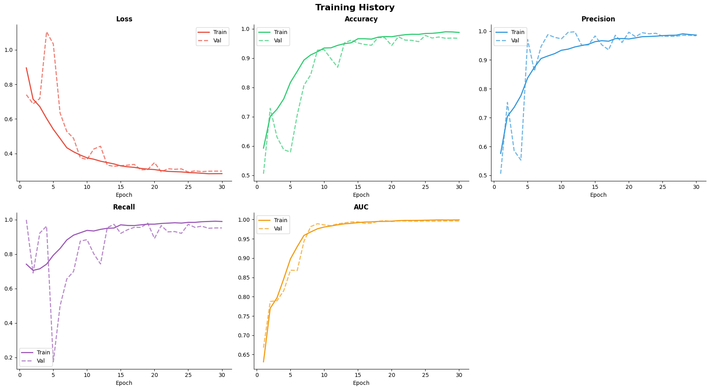
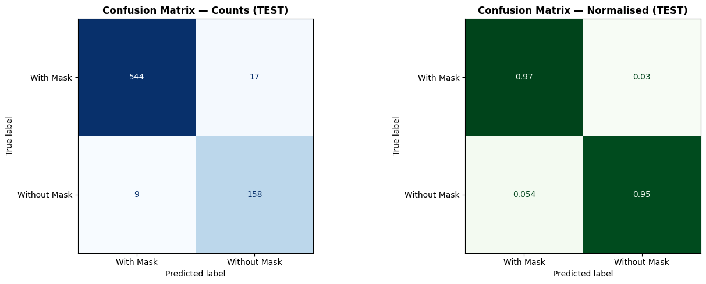
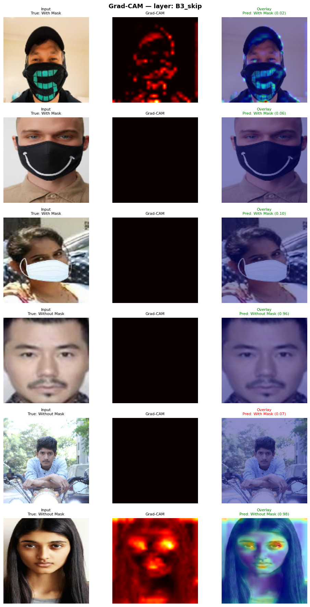

# Face Mask Detection: CNN + OpenCV (MaskCNN_v2)

A real-time face mask detector built from scratch. A custom convolutional neural network (**MaskCNN_v2**, ~316K parameters) classifies a face as **`with_mask`** or **`without_mask`**. It is paired with OpenCV's DNN SSD face detector so it can run live on a webcam or a video file.

> Course project for **GEL521 – Machine-Learning Control** (Project 5 – OpenCV Mask Detection), Spring 2025-26.

| Metric (held-out test set, 728 images) | Value |
|---|---|
| Accuracy | **96.43 %** |
| ROC-AUC | **0.9939** |
| F1-score (`without_mask` as positive class) | 0.924 |
| Precision / Recall (`without_mask`) | 0.903 / 0.946 |
| Misclassifications | 26 / 728 (17 FP, 9 FN) |
| Model size | 315,793 parameters (~3.9 MB) |

---

## ⚠️ Important: the dataset is NOT fully included

The full image dataset (~7,000+ images) is **too large for GitHub and was not uploaded**.

- The **`data/` folder used in training is not in this repository.**
- The **`data-/` folder** (note the trailing dash) is a **placeholder sample**. It only shows the expected folder layout, with **one example image per class**:

```
data-/
├── with_mask/
│   └── with_mask_12.jpg
└── without_mask/
    └── without_mask_22.jpg
```

You **cannot retrain or evaluate the model using `data-/` alone.** To reproduce training, download the dataset yourself (see [Getting the dataset](#getting-the-dataset)).

You **do not need the dataset to run the trained model.** The trained weights in `best_model_configuration/` are enough for live webcam or video detection.

---

## Repository structure

```
binary_class_model/
├── best_model_configuration/        # Everything needed for inference
│   ├── mask_cnn_final.keras         # Full trained model (architecture + weights)
│   ├── best_mask_cnn.weights.h5     # Best checkpoint weights only (lowest val_loss)
│   ├── config.json                  # Hyperparameters, metrics, class map, threshold, input size
│   ├── deploy.prototxt              # OpenCV DNN SSD face detector – network definition
│   └── res10_300x300_ssd.caffemodel # OpenCV DNN SSD face detector – pretrained weights
│
├── notebooks/
│   ├── mask_detection_CNN_grid_search.ipynb    # Full pipeline incl. KerasTuner Hyperband search (Colab)
│   ├── mask_detection_CNN_winning_params.ipynb # Same pipeline, winning hyperparameters hardcoded (Colab)
│   └── mask_detector_pycharm_testing.ipynb     # Local live testing: 12 OpenCV webcam experiments
│
├── illustrations/                   # Figures generated by the training notebook
│   ├── class_balance.png
│   ├── random_samples_train_split.png
│   ├── data_augmentation.png
│   ├── training_curves.png
│   ├── validation_confusion_matrix.png
│   ├── validation_roc.png
│   ├── threshold_sensitivity.png
│   ├── testing_confusion_matrix.png
│   ├── testing_roc.png
│   ├── mean_max_activation_per_maxpool_layer.png
│   └── grad_cam.png
│
├── documentation/
│   ├── MaskCNN_Complete_Documentation.pdf   # Full technical report (theory, design, results)
│   └── MaskCNN_Complete_Documentation.docx  # Editable version of the report
│
└── data-/                           # PLACEHOLDER: 1 sample image per class (see warning above)
```

---

## How the system works

```
Webcam / video frame
        │
        ▼
OpenCV DNN SSD face detector (res10_300x300, Caffe)   → bounding boxes for every face
        │
        ▼
Crop each face → BGR→RGB → resize 128×128 → scale to [0,1]
        │
        ▼
MaskCNN_v2 (Keras) → sigmoid output = P(without_mask)
        │
        ▼
Threshold 0.5 → green box "With Mask" / red box "Without Mask" + confidence %
```

**Output semantics:** the network has a single sigmoid output. Class index `0 = with_mask` and `1 = without_mask`, so the raw output is the probability that the face is **not** wearing a mask. The threshold and class map are stored in `config.json`.

---

## Model architecture (MaskCNN_v2)

A CNN built from scratch (no transfer learning), with residual skips, batch normalization and spatial dropout.

| Block | Layers | Filters |
|---|---|---|
| Input | 128 × 128 × 3 | – |
| Block 1 | (Conv3×3 → BN → ReLU) ×2 → MaxPool | 16 |
| Block 2 | (Conv3×3 → BN → ReLU) ×2 **+ 1×1 residual skip** → MaxPool | 64 |
| Block 3 | (Conv3×3 → BN → ReLU) ×2 **+ 1×1 residual skip** → MaxPool → SpatialDropout2D(0.25) | 128 |
| Head | GlobalAvgPool → Dense(256) → BN → ReLU → Dropout(0.6) → Dense(1, sigmoid, float32) | – |

An optional 4th block was part of the search space. The tuner turned it **off**: the smaller 3-block model generalized better on this dataset size.

### Hyperparameter search

**KerasTuner Hyperband** (objective `val_accuracy`, max 15 epochs/trial, factor 3, 2 iterations) ran **38 trials in ~84 min** on a Colab T4 GPU. The best validation accuracy during the search was **0.970**.

| Hyperparameter | Search space | Winner |
|---|---|---|
| filters_1 / 2 / 3 | {16,32} / {32,64} / {64,128} | 16 / 64 / 128 |
| dense_units | {128, 256, 512} | 256 |
| dropout_1 (spatial) | {0.25, 0.4, 0.5} | 0.25 |
| dropout_2 (dense) | {0.4, 0.5, 0.6} | 0.6 |
| learning_rate | {1e-3, 5e-4, 1e-4} | 1e-3 |
| l2_reg | {0, 1e-4, 1e-3} | 1e-4 |
| use_block4 | {True, False} | False |
| label_smoothing | {0.0, 0.1} | 0.1 |

### Training setup

- **Optimizer:** Adam with a custom `WarmupCosineSchedule` (5 warm-up epochs, then cosine decay)
- **Loss:** Binary cross-entropy with label smoothing 0.1
- **Epochs:** 30, batch size 64, best epoch = 25. EarlyStopping (patience 8) and ModelCheckpoint both monitor `val_loss`.
- **Mixed precision:** `mixed_float16`
- **Class weights:** balanced (≈1.01 / 0.99, so the dataset is nearly balanced)
- **Augmentation (train split only, `tf.data` + `tf.image`):** horizontal flip, brightness ±0.3, contrast 0.8–1.2, random zoom-crop (80–100 %), rotation ±20°
- **Speed trick:** copying the dataset from Google Drive to Colab's local SSD cut step time from ~15 s to ~0.08 s.

---

## Results

| Split | Images | Accuracy | Precision | Recall | F1 | ROC-AUC |
|---|---|---|---|---|---|---|
| Validation* | 1,134 | 97.71 % | 0.982 | 0.972 | 0.977 | 0.9963 |
| **Test** | **728** | **96.43 %** | **0.903** | **0.946** | **0.924** | **0.9939** |

\*Validation numbers are slightly optimistic because the checkpoint was selected on this set. The test set was never used during training or model selection.

The threshold sweep on the validation set confirmed **0.5** as the F1-optimal decision threshold.

**Explainability:** Grad-CAM heatmaps (`illustrations/grad_cam.png`) show the network focusing on the **nose/mouth region**: the mask fabric for `with_mask` faces and the exposed lower face for `without_mask`. This suggests it learned meaningful features, not background cues.

| Training curves | Test confusion matrix | Grad-CAM |
|---|---|---|
|  |  |  |

---

## Getting started

### Option A: Run the trained model live (no dataset needed)

1. Clone the repository:
   ```bash
   git clone <this-repo-url>
   cd binary_class_model
   ```
2. Install dependencies (Python 3.10+ recommended):
   ```bash
   pip install tensorflow opencv-python numpy matplotlib pillow jupyter
   ```
3. Copy these files from `best_model_configuration/` **into `notebooks/`**, next to the testing notebook (or edit the paths in Cell 3):
   - `mask_cnn_final.keras`
   - `config.json`
   - `deploy.prototxt`
   - `res10_300x300_ssd.caffemodel`
4. Open `notebooks/mask_detector_pycharm_testing.ipynb` (PyCharm, VS Code or Jupyter). Run **Cells 1–4 in order**, then any experiment.

> **Do not skip Cell 3.** The saved `.keras` file references the custom `WarmupCosineSchedule` class. That class must be defined and registered before `keras.models.load_model()` is called, or loading fails with `Unknown object: WarmupCosineSchedule`.

#### Available live experiments (press `Q` to quit each one)

| # | Experiment | What it shows |
|---|---|---|
| 1 | Basic webcam detection | Green/red boxes + confidence |
| 2 | FPS counter | Inference speed on your hardware |
| 3 | Confidence bar | Per-face mask vs no-mask probability bar |
| 4 | Threshold slider | Effect of moving the decision threshold live |
| 5 | Grayscale input | Does the model rely on color? |
| 6 | Blur robustness | Gaussian blur slider (low-res / distant faces) |
| 7 | Brightness & contrast | Dim rooms, harsh light, overexposure |
| 8 | Original vs Canny edges | Side-by-side edge view |
| 9 | Session statistics | Frame/face counts, mask ratio, avg confidence |
| 10 | Video file + save | Runs on `test_video.mp4`, writes `annotated_output.mp4` |
| 11 | Snapshot chart | Press `S` for a matplotlib probability chart per face |
| 12 | No-mask alarm | Flashing "MASK REQUIRED" warning, access-control style |

### Option B: Retrain from scratch (dataset required)

The training notebooks were written for **Google Colab with a GPU**.

| Notebook | Use it when |
|---|---|
| `mask_detection_CNN_grid_search.ipynb` | You want to re-run the full Hyperband search (~60–90 min on a T4) and then train |
| `mask_detection_CNN_winning_params.ipynb` | You want to skip the search and train directly with the winning hyperparameters (a few minutes) |

Both notebooks follow the same 14 sections: environment setup → dataset audit → `tf.data` pipeline → architecture → HPO / winning params → training → curves → validation → test → feature maps → Grad-CAM → save model & `config.json` → real-time demo.

Steps:
1. Get the dataset (below) and arrange it in the **pre-split** layout:
   ```
   data/
   ├── train/  ├── with_mask/  └── without_mask/
   ├── val/    ├── with_mask/  └── without_mask/
   └── test/   ├── with_mask/  └── without_mask/
   ```
2. Upload `data/` to your Google Drive at `MyDrive/data`, or change `DRIVE_DATA` in Section 2 of the notebook.
3. Open the notebook in Colab, set the runtime to **GPU**, and run all cells. The notebook copies the data to Colab's local SSD automatically.
4. The outputs are `mask_cnn_final.keras`, `best_mask_cnn.weights.h5`, `config.json` and `training_log.csv`. Colab saves them in `/content/` and downloads the model and config.

---

## Getting the dataset

The model was trained on the **[Kaggle Face Mask Detection dataset by Omkar Gurav](https://www.kaggle.com/datasets/omkargurav/face-mask-dataset)**. The files follow the naming pattern `with_mask_<n>.jpg` / `without_mask_<n>.jpg`, as in the `data-/` samples.

After downloading, split the images into `train / val / test` folders as shown above. The split used for the reported results was:

| Split | Images | Share |
|---|---|---|
| Train | 5,296 | ~74 % |
| Validation | 1,134 | ~16 % |
| Test | 728 | ~10 % |
| **Total** | **7,158** | |

Your numbers may differ slightly depending on how you split the data and which images you keep.

---

## Tech stack

- **TensorFlow / Keras**: model, training, mixed precision
- **KerasTuner**: Hyperband hyperparameter optimization
- **OpenCV**: DNN SSD face detection, video I/O, drawing, live experiments
- **scikit-learn**: metrics, confusion matrices, ROC, class weights
- **NumPy, Matplotlib, Seaborn**: analysis and figures
- **Google Colab (T4 GPU)** for training, **PyCharm** for local testing

---

## Known limitations

- Two classes only. There is no "mask worn incorrectly" class, so a mask under the nose may be classified either way.
- Performance depends on the face detector. Faces the SSD misses (very small, extreme angles, heavy occlusion) are never classified.
- The training images are mostly frontal, cropped faces. Accuracy can drop in unusual lighting, at low resolution, or with unusual mask colors and patterns (see Experiments 5–7).

---

## Further reading

`documentation/MaskCNN_Complete_Documentation.pdf` is the full report. It covers CNN and OpenCV theory, dataset analysis, every design decision, the hyperparameter search, detailed results, Grad-CAM and feature-map analysis, and the deployment pipeline.
